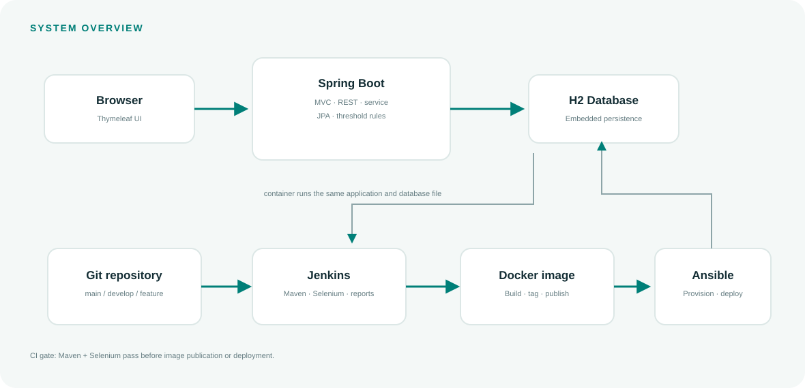

# Application and Delivery Architecture

## Request path

Browser requests render through Spring MVC and Thymeleaf. The JSON API uses the same service layer. UsageService reads and writes UsageRecord entities through Spring Data JPA to the embedded H2 database. Alert state is derived from each saved record, so the web page and API apply the same 80% and 100% rules.

## Delivery path

Git changes trigger Jenkins. Jenkins checks out the selected branch, runs Maven verification (including Selenium journeys), archives the packaged jar, and only then enters optional Docker build/publish/deploy stages. Ansible prepares a Linux/WSL host and runs the chosen image. The health endpoint supports post-deployment checks.

## Technology rationale

- Java 17 and Spring Boot provide a structured web/API service suitable for the course's Maven and Jenkins tasks.
- Thymeleaf keeps the dashboard server-rendered and requires no external frontend toolchain.
- H2 keeps local setup self-contained; a managed production database is outside the MVP.
- Selenium's headless HtmlUnit WebDriver gives repeatable browser-style form/search journeys without installing a separate Chrome binary.
- Docker and Ansible make image and host configuration repeatable.

