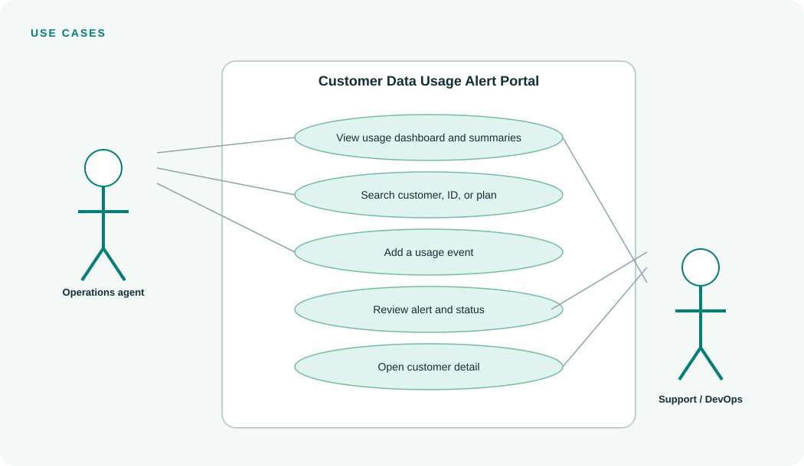

# Use-case Diagram and Notes

## Use cases

| Actor | Use case | Result |
|---|---|---|
| Operations agent | View dashboard | Summary and current usage records appear |
| Operations agent | Search usage | Matching customer/plan rows appear |
| Operations agent | Add usage event | A validated record is saved |
| Support representative | Review alert | Warning/exceeded records are listed |
| Support representative | Open customer detail | Plan and threshold explanation are shown |
| Admin / DevOps | Configure and deploy | Environment is deployed and health checked |

